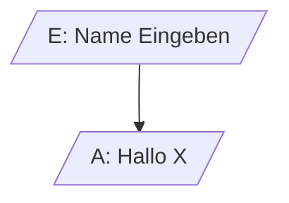
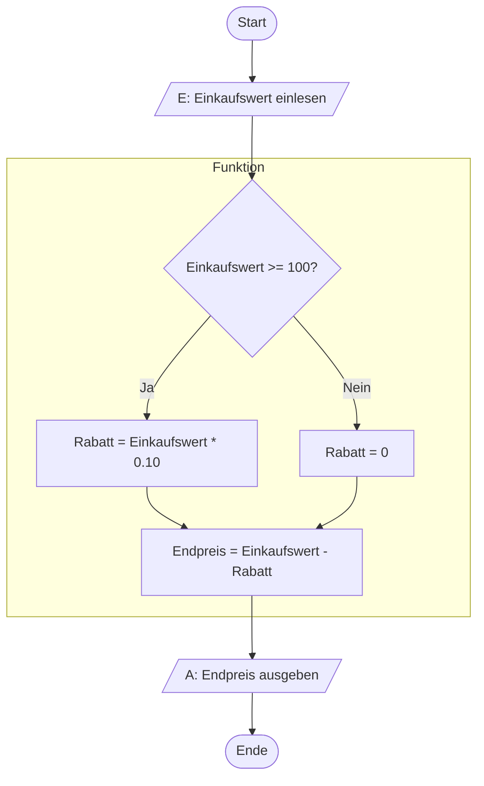

# PAP zu Code

**Lesen Sie zuerst die `mermaid.md`** und installieren Sie das _mermaid_-Plugin für IntelliJ (wie beschrieben).

## Ein- und Ausgabe
Ein- und Ausgabe wird mit einem Parallelogramm (einer "schiefen" Box) dargestellt. Was eine Eingabe oder eine Ausgabe ist,
ist aber nicht genormt. Wir werden im Unterricht Eingeben mit einem `E: ` und Ausgaben mit einem `A: ` kennzeichnen.

## Aufgabe
Erstellen Sie eine Funktion `calculateDiscount()` und implementieren Sie die Logik aus
folgendem PAP. Ein- und Ausgabe sollen nicht _in_ der Funktion implementiert werden.

