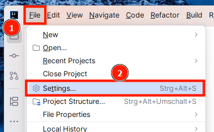
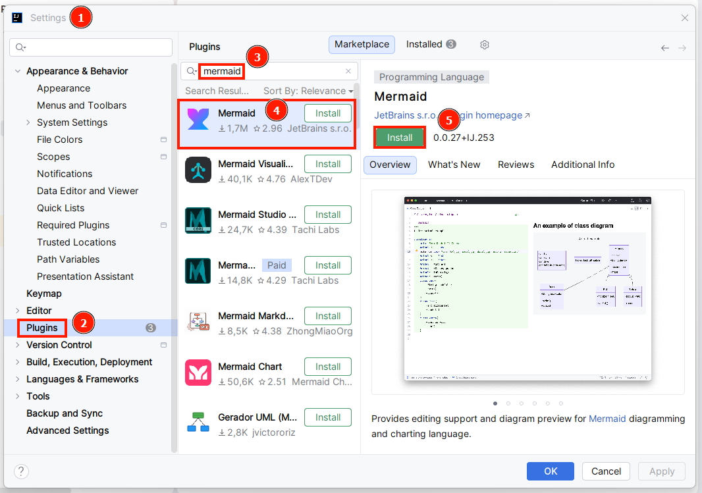
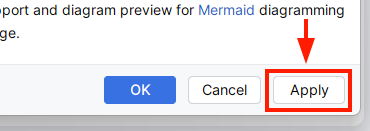
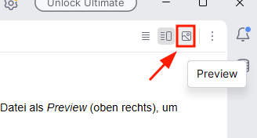
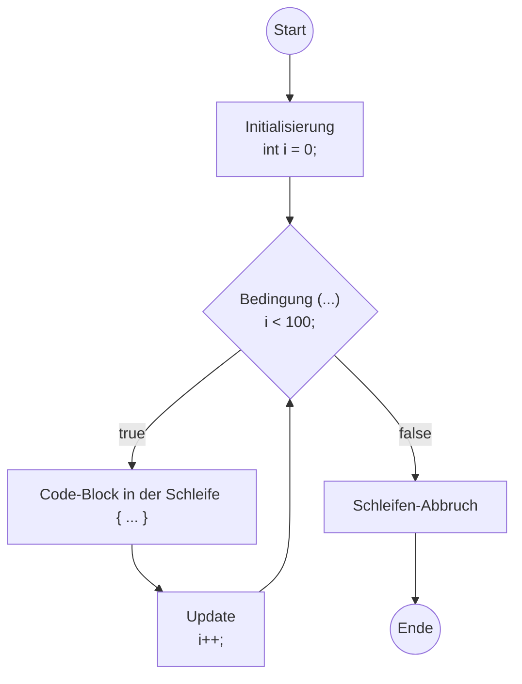

# Programmablaufplan (PAP)
Programmablaufpläne dienen dazu einen Ablauf visuell darzustellen. Diese Diagram-Art eignet
sich sehr gut für Software, solange die Instruktionen im Diagram detailiert genug sind.
Ist das der Fall, lässt sich ein Diagram fast 1 zu 1 in Programmcode abschreiben.

Informatiker können sich so untereinander oder mit Ihren Kunden über komplexe Abläufe und
Busineslogik austauschen. Gerade Kunden ohne Fachhintergrund können Ihre Businesslogik mit
PAPs effektiv beschreiben.

Schauen Sie [hier](https://de.wikipedia.org/wiki/Programmablaufplan) nach,
aus welchen Elementen das Diagram besteht. In der offiziellen
[DIN 66001](https://link.springer.com/chapter/10.1007/978-3-322-86222-8_4)
finden sie auch einen Überblick.

Denken Sie daran, dass ein Ablauf entweder mit einem simplen PAP mit wenigen Elementen beschrieben werden
kann, oder detailliert mit vielen Elementen. Das richtige _Abstraktionslevel_ zu finden liegt in
Ihrem ermessen. Denken Sie, wie beim Formulieren eines Textes auch, immer an den Leser. Was
sind wichtige und was sind nicht wichtige Details?

## [draw.io](https://draw.io)
[draw.io](https://draw.io) ist ein beliebtes und verbreitetes Tool, um Diagramme in allen Arten
und Formen mit einer grafischen Oberfläche zu erstellen. Hier stehen Ihnen Werkzeuge
zur Verfügung, um frei Diagramme ohne konkreten Formzwang zu erstellen.

Bearbeiten Sie die Aufgaben im Unterricht **mit diesem Programm (oder der Webversion).**

## [Mermaid Plugin](https://mermaid.ai/open-source/syntax/flowchart.html)
Bilder zu exportieren und in Dokumentationen einzufügen funktioniert in der Praxis prinzipiell gut,
es geht aber auch etwas flexibler mit Text-to-Diagram Tools wie z. B.
[mermaid](https://mermaid.ai/open-source/syntax/flowchart.html).
Wir werden im Unterricht **keine _mermaid_-Diagramme selbst erstellen** aber
einige Diagramme werden Ihnen als _mermaid-Text_ zur Verfügung gestellt.
Damit Sie diese Diagramme _sehen_ können, müssen Sie das 
[IntelliJ-Mermaid-Plugin](https://plugins.jetbrains.com/plugin/20146-mermaid) installieren. Das geht
innerhalb von IntelliJ zum Glück mit ein paar Klicks.

## Beispiel
Öffnen Sie diese Markdown-Datei als _Preview_ (oben rechts), um Ihre Mermaid-Installation zu testen.

In folgendem Beispiel wird eine Schleife als PAP dargestellt (ganz unten in dieser Datei).
Wenn Sie ein Diagram mit Kästen und Pfeilen sehen, dann funktioniert das mermaid-Plugin in Ihrer IDE korrekt.

