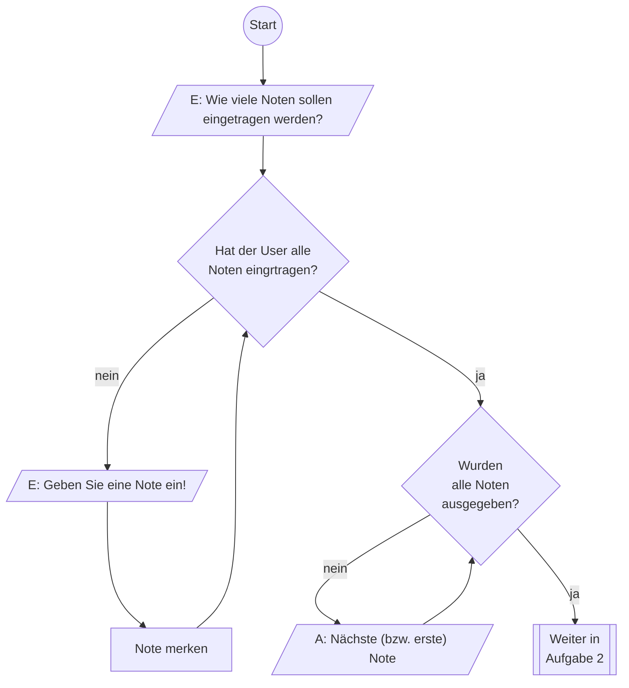
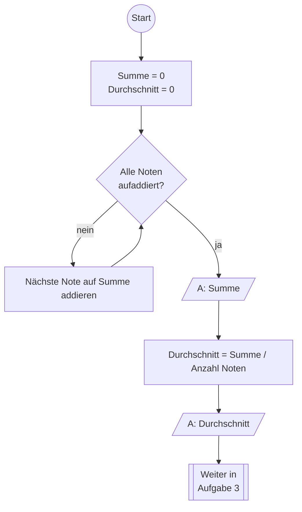
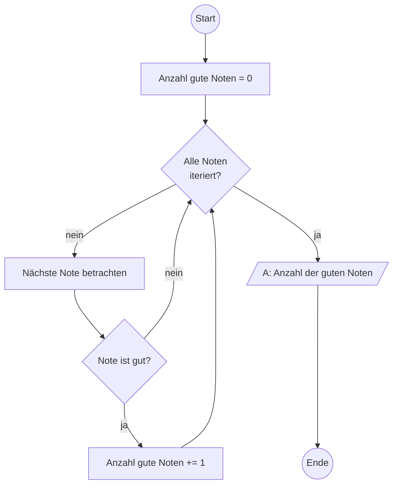

# Code zu PAP
Folgende Diagramme sind _mögliche_ Darstellung für die Java-Musterlösungen in
`_03_ArrayGrades/GradeCalc_Solution.java`

## Aufgabe 1 (Musterlösung)
In diesem PAP wird der User zu Beginn nach der Anzahl der Noten gefragt.
Diese Logik müsste in der Musterlösung noch ergänzt werden. Z. B. so:
```java
String userInput = IO.readln("Wie viele Noten sollen eingetragen werden? ");
double[] grades  = new double[Integer.parseInt(userInput)];
```


## Aufgabe 2 (Musterlösung)


## Aufgabe 3 (Musterlösung)

